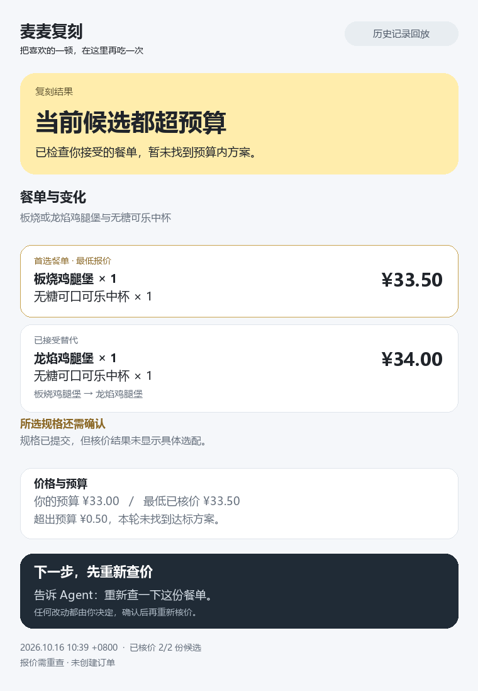

# 麦麦复刻

**分享一份餐单目标，让 Agent 在你的门店重新执行。**

收到朋友的餐单，导入配方，选择自己的门店。麦麦复刻通过麦当劳 MCP 重新查菜单、匹配允许替代的餐品并整单核价，说明哪些目标保留、哪些改变、哪里仍需你决定。

v0.1.0 是到店、无券、只读核价版本，适合已有 WorkBuddy 和麦当劳 MCP 的开发者及希望复用常用餐单的用户。不创建订单，不自动支付；非麦当劳官方产品。参赛发布准备中，尚未报名。



*以上为2026-10-16历史回放，不是当前有效报价。卡片依次展示复刻结果、餐单与变化、价格预算和下一步。*

## 为什么要重新执行

配方保存的是预算、份数、餐品目标和你接受的替代。朋友的门店、个人券和旧报价不随配方共享。接收者在自己的上下文重新查询，不能原样复现时解释原因；所有已接受候选仍超预算或不可售时，停下来由你决定。

## 三步开始

1. 在 WorkBuddy 的技能管理中上传并启用 [mcfuke-validation.zip](downloads/mcfuke-validation.zip)，新对话显式选择该技能。
2. 配置本人麦当劳 MCP，解压 [meal-share.zip](downloads/meal-share.zip)，把 meal.recipe.json 交给对话。
3. 确认条件与门店，让技能重新查询、核价并展示结果卡。默认工作区可用，不需要开发者的项目目录。

完整图文操作步骤、手机连接电脑方式与常见问题见 [安装说明](docs/INSTALL.md)。当前未验证手机云端独立执行。

可以直接发送：

> 使用麦麦复刻技能，读取 meal.recipe.json，先展示预算、份数、餐品与允许替代让我确认。按我选择的门店查询当前菜单并核价，完成后直接展示结果卡。超预算或不可售时如实停止，不擅自换菜、不扩大预算、不下单或发布。

示例配方是33元、板烧首选/龙焰替代、无糖可乐中杯。它只表达目标，不保证任意门店有货或在预算内。

## v0.1 能做什么

- 严格校验配方，导出只有目标数据与文本卡的分享包。
- 根据本店当前资料匹配已接受候选，生成最多5份完整核价请求。
- 由 WorkBuddy 原生 MCP 实际核价，程序检查请求、回执、数量、金额、预算和本地时效。
- 解释已接受替换、超预算、不可售、缺失回执和未知选配。
- 生成 SVG 结果卡，区分模拟、历史回放与本轮核价。

脚本自身不联网，宿主负责真实 MCP 调用。本地 JSON、模式标签和指纹不认证官方来源。配方不接受凭据、券和账号等额外字段，自由文本仍需检查隐私。

本版未适配有券计价、外送、订单创建/支付/回查。饮料报价可能仅回显顶层容器，未回显具体选配时继续标未知，不靠杯型价差认定无糖已确认。

## 验证到哪一步

49项本地测试通过，含公开包文件清单与凭据拦截检查；四轮结构化 WorkBuddy 导出覆盖两店核价、已接受替代后超预算、早餐不可售和程序完整核价衔接。默认工作区技能加载、配方交互与新版结果卡展示已有截图确认。

项目所有者反馈另一位朋友已验证；尚未取得详细脱敏过程，也没有持续复用或大规模需求数据。完整范围见 [验证摘要](docs/VALIDATION.md)。

## 本地运行

Python 3.10或以上，核心代码无第三方依赖：

```text
python -m mcfuke
python -m unittest discover -s tests -v
```

默认演示为纯模拟，商品、门店和价格均为虚构，不连接官方 MCP。

```text
python skills/mcfuke-validation/scripts/run.py validate --recipe examples/replacement.recipe.json
python skills/mcfuke-validation/scripts/run.py share --recipe examples/replacement.recipe.json --output dist/meal-share.zip
```

原生查询后如何建立绑定、生成请求和保存回执，见 [流程格式](skills/mcfuke-validation/references/workflow.md)。结果卡命令：

```text
python skills/mcfuke-validation/scripts/run.py card --job quote-job.local.json --receipts quote-receipts.local.json --output quote-result.svg
```

live报价超过120秒或资料超过600秒需重查；这是本地策略，不是官方有效期。历史演示使用真实记录复核时点并加 --historical-at，卡片始终标记历史回放。

## 后续更新

优先改善安装与复用体验，再在同一项目加入“今日心情餐”趣味入口；该功能尚未实现。有券适配、具体方案确认、创建与状态回查保留在后续计划，不宣传为当前能力。见 [更新记录](CHANGELOG.md)。

## 项目与参赛材料

- [麦当劳 MCP 集成](MCP_INTEGRATION.md)
- [WorkBuddy 实际使用记录](workbuddy.md)
- [官方参赛声明](CONTEST_DECLARATION.md)，按要求原样保留
- [配置示例](mcp-config.example.json)，只有环境变量占位符
- [发布与报名说明](docs/CONTEST_SUBMISSION.md)
- [素材与来源](NOTICE.md)、[MIT 许可证](LICENSE)

程序主体借助 Codex 编写，WorkBuddy 用于真实 MCP 接入、业务联调和技能运行，不将其描述为 WorkBuddy 独立完成全部开发。专项资格与参赛资格由主办方审核。GitHub 仓库与报名 Issue 尚未创建，不承诺获奖。
